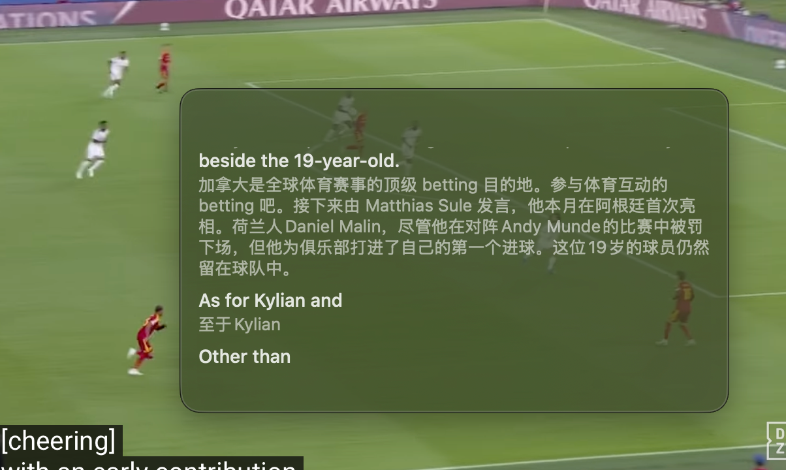
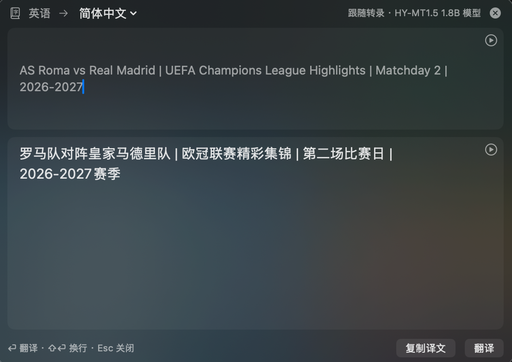
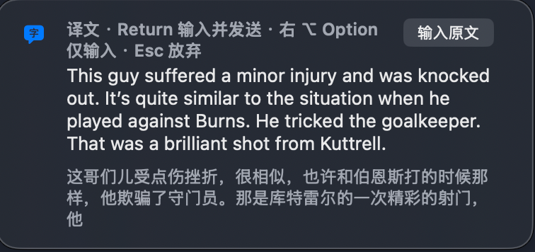

# OmniVoice

**English | [简体中文](README.zh-CN.md)**

**Real-time transcription, translation and voice input for macOS — on-device by default.**

OmniVoice is a menu-bar app for lectures, meetings and multilingual
conversations. It captions what it hears in a floating window, translates
text and screenshots anywhere on screen, and types what you dictate into any
app. Speech recognition and translation run on macOS's built-in frameworks
or on local models — no cloud service is required.

**Current version: 0.9.0 — internal test build.**

### [⬇ Download OmniVoice 0.9.0 (.dmg)](https://github.com/hdcola/OmniVoice/releases/download/v0.9.0/OmniVoice-0.9.0.dmg)

Or install with [Homebrew](https://brew.sh):

```bash
brew tap hdcola/tap
brew trust hdcola/tap      # Homebrew 7+ only
brew install --cask omnivoice
```

This build is **self-signed (OmniVoice Dev Signing), not notarized**: macOS refuses to open it
until you clear its quarantine flag (`xattr -cr /path/to/OmniVoice.app`).
See [`Docs/RELEASE_TESTING.md`](Docs/RELEASE_TESTING.md) for details and the
permissions it asks for.

## Features

OmniVoice has no main window; everything lives in the menu bar, the caption
panel and the Settings window. The UI is currently Chinese-only; feature names here are English
translations of its labels.

### Live transcription & translation



- **Caption panel** — a semi-transparent, draggable, resizable
  window that stays on top without stealing focus and remembers its position.
  Bilingual / translation-only / source-only display, three font sizes,
  adjustable background and content opacity, auto-scroll with a "latest"
  jump button, per-line and whole-transcript copy, live mic level and
  elapsed time. Controls fade out when the pointer leaves.
- **Languages** — about 16 quick-pick languages (Chinese, English, Japanese,
  Korean, French, German, Spanish, Italian, Portuguese, …). Set "my language" and
  "foreign language" once; recording, Quick Translate and voice input share them. A ⇄
  button swaps the pair, and "auto" detects the source with a local model.
- **Audio sources** — pick a microphone (or none), and optionally include
  system audio through ScreenCaptureKit to caption a meeting or video.
- **Tunable segmentation** — pause length and silence threshold for
  splitting speech into utterances, plus when long sentences are translated
  early.
- **History** — transcripts are saved locally with SwiftData:
  searchable, grouped by date, renamable, multi-select delete, "delete older
  than 30/90 days", copy full text or translation only, Markdown export.


### Quick Translate

Runs fully on-device.



- **Translate selection (⌥A)** — select text in any app and press
  ⌥A. Optionally, press ⌘C twice (⌘C ⌘C) to translate what you just copied.
- **Translate screenshot (⌥S)** — frame part of the screen; text is
  recognized locally with Vision.
- **Translation panel** — text in your language goes to your foreign
  language, everything else comes into your language. Long text fills in paragraph
  by paragraph and keeps its line breaks and list markers. ⏎ translates,
  ⇧⏎ adds a newline, Esc hides. Either pane can be read aloud with macOS
  system voices, optionally automatically.
- URLs, paths, CLI flags and code identifiers are protected from translation
  distortion.

### Voice input (opt-in)

Hold the right ⌥ Option key (or right ⌘ / ⌃), or tap to start and tap again
to stop, in any app. Speak, and the text is typed at the cursor.

- Uses system speech recognition, or borrows the local model if it is
  already loaded for transcription.
- A bubble shows what it hears; Esc cancels; a time limit (default 2 min)
  closes the microphone if a key release is lost.
- In tap mode, Return ends the dictation, types the text and presses Return
  (for chat apps and prompts).
- **Translate before typing** — review the translation into your foreign language in the
  bubble, then type it or the original.

  
- **LLM polish** — optionally clean up punctuation, filler words and
  lists with your own OpenAI-compatible service (OpenAI, DeepSeek, Zhipu,
  Ollama or a custom Base URL). Off by default; the API key is kept in the
  Keychain; any failure types the original text. For a local model, Google's
  [Gemma 4 E2B](https://lmstudio.ai/models/google/gemma-4-e2b) (via LM Studio)
  has tested well enough.

### Engines & models

| | System (built in, no download) | Local models (offline) |
|---|---|---|
| Speech recognition | `SpeechAnalyzer` / `SpeechTranscriber` | R2T2 (Q4_K_M / Q8_0 / F16) via audio.cpp; small streaming Zipformer / Paraformer models via sherpa-onnx |
| Translation | `Translation` framework | HY-MT1.5 1.8B (light), T3PO (high quality) |

Choose the recognition and translation engines independently. Local models
run in-process through `audio.cpp` and `llama.cpp`. The **Model Library**
downloads them with progress, disk-space checks and SHA-256 verification,
shows memory use, and can preload models at launch. The
first-run wizard has three steps — permissions and switches, then a
speech recognition model, then a translation model — and shows each choice's
memory use next to your Mac's memory.

### App

A menu bar popover with the transcription status (live mic level, elapsed
time, missing permissions), start/stop, the language pair, audio source,
Quick Translate and the three latest transcripts; a pulsing recording
indicator in the menu bar; a global Start/Stop Transcription shortcut (⌥R,
changeable in Settings → General → Shortcuts); launch at login,
Dock icon only while Settings or the wizard is open, system notifications
when a download finishes, a re-runnable first-run guide, and a
what's-new window after updates. Settings has six tabs (⌘1–⌘6): General, Speech
Recognition, Dictation, Quick Translate, Model Library, About.

## Requirements

- macOS 26 or later (`SpeechAnalyzer`/`SpeechTranscriber` and the
  `Translation` framework APIs are macOS 26+).
- Local models are optional downloads: the balanced bundle (R2T2 +
  HY-MT1.5) is about 3.4 GB; the Model Library shows each model's memory use.
- To build from source: a Swift 6.2+ toolchain.

## Permissions

Requested only when the feature needs them: Microphone and Speech
Recognition (transcription), Screen Recording (system audio, ⌥S),
Accessibility (⌥A, typing dictated text, pausing music with the play/pause key during dictation), Input
Monitoring (Dictation, ⌘C ⌘C).

## Building from source

```bash
swift build             # debug build
swift test              # unit tests
./Scripts/build_app.sh  # package an ad-hoc-signed .app into build/
                        # (uses the "OmniVoice Dev Signing" cert if present, see Docs/SIGNING.md)
./Scripts/build_dmg.sh  # wrap that .app into a .dmg (run build_app.sh first)
```

Local model engines need their upstream sources built first — see
[`Docs/MODEL_ENGINE_SETUP.md`](Docs/MODEL_ENGINE_SETUP.md) (or run
`Scripts/setup_third_party.sh`).

## Not yet implemented

- Notarized release, auto-update and crash reporting

## Documentation

- [`CHANGELOG.md`](CHANGELOG.md) — what changed in each version
- [`Docs/PROGRESS.md`](Docs/PROGRESS.md) — architecture, decisions, open items
- [`Docs/GLOSSARY.md`](Docs/GLOSSARY.md) — naming used in UI and docs
- [`Docs/RELEASING.md`](Docs/RELEASING.md) — cutting a release
- [`AGENTS.md`](AGENTS.md) — contribution workflow

## License

Apache License 2.0 — see [`LICENSE`](LICENSE).

## Acknowledgements

Thanks to these projects:

- [Cida](https://github.com/Xuanwo/cida) — inspiration for Quick Translate
- SnapTra Translator — inspiration for the card-style Settings
- [audio.cpp](https://github.com/0xShug0/audio.cpp) and [llama.cpp](https://github.com/ggml-org/llama.cpp) — in-process local inference
- [R2T2](https://huggingface.co/davidxifeng/Confucius4-R2T2-gguf) and [T3PO](https://huggingface.co/netease-youdao/Confucius4-T3PO-GGUF) (NetEase Youdao Confucius4) — local speech recognition and translation models
- [HY-MT1.5](https://huggingface.co/tencent/HY-MT1.5-1.8B-GGUF) (Tencent) — local translation model
